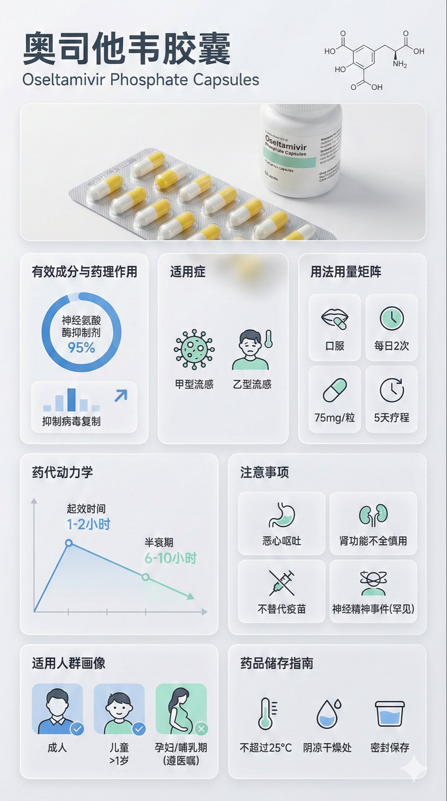

# 图片保存手动操作指南

由于技术限制无法直接获取Twitter图片，请按以下步骤手动保存：

## 方法1：直接从Twitter保存（推荐）

1. **打开推文链接**
   ```
   https://x.com/linxiaobei888/status/2005552861753827692
   ```

2. **右键点击图片** → 选择"图片另存为"

3. **保存到**
   ```
   /Users/timon/Library/Mobile Documents/iCloud~md~obsidian/Documents/iCloud Vault/04_灵感与碎片/优质提示词记录/图片/
   ```

4. **重命名文件**
   ```
   药物科普海报_原始推文.jpg
   ```

## 方法2：使用截图工具

### Mac
1. 打开推文链接
2. 按 `Cmd + Shift + 4` 截图
3. 保存到上述目录

### Windows
1. 打开推文链接
2. 使用Windows截图工具（Win + Shift + S）
3. 保存到上述目录

## 图片命名建议

```
药物科普海报_原始推文.jpg
药物科普海报_MJ参数.jpg
药物科普海报_生成效果.jpg
```

## 需要从图片中提取的信息

保存图片后，请在主笔记文件中补充以下信息：

1. **Midjourney参数**
   - --ar (宽高比)
   - --v (版本号)
   - --stylize (风格化程度)
   - --quality (质量)

2. **完整的英文提示词**
   - 从图片中提取完整文本
   - 保留原有格式

3. **生成效果**
   - 描述图片生成效果
   - 记录优缺点

## 完成检查清单

- [ ] 已保存原始推文图片
- [ ] 已提取完整提示词
- [ ] 已记录MJ参数
- [ ] 已补充到主笔记
- [ ] 已设置文件引用（Obsidian）

## Obsidian中引用图片

在主笔记中添加：
```markdown

```

---
**创建时间**：2025-12-30
**用途**：辅助药物科普海报提示词笔记
