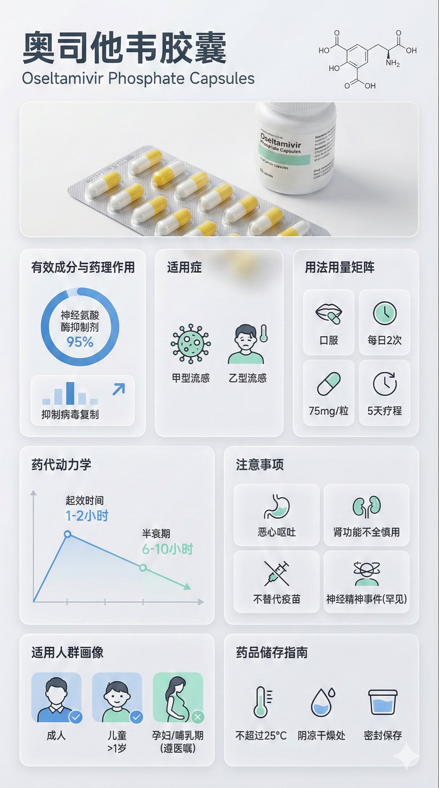
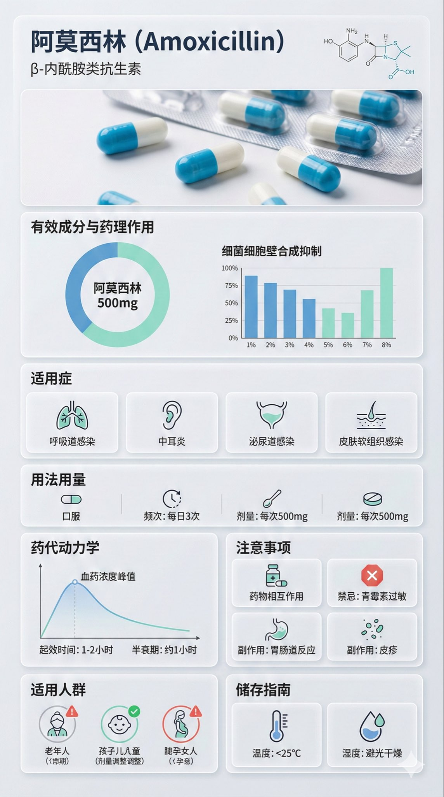

# 药物科普高质量海报 - Midjourney提示词

> 来源：林小北(@linxiaobei888)的Twitter帖子
> 用途：生成药物/医疗科普信息海报

## 提示词内容

### 中文版本

```
Nano Banana Pro Prompt:  
  
{ "image_analysis": { "subject": "[药物名称] 科普信息图，9:16", "style": "模块化Bento Grid设计 (便当盒网格布局) / 极简医疗UI设计", "tone": "专业、临床、严谨、科学、值得信赖", "primary_colors": ["临床白 (Clinical White)", "医疗蓝 (Medical Blue)", "石板灰 (Slate Grey)", "薄荷绿 (Mint Green)"] }, "prompt_elements": { "subject_description": "一张关于 [药物名称] 的高质量科普信息海报。", "layout": "便当盒风格的模块化网格布局，干净的医疗UI/UX界面设计，分为清晰的矩形卡片。", "visual_details": [ "顶部页眉带有醒目的无衬线现代字体标题“药物中文名称”及其化学/通用名", "顶部中央是 [药物剂型/包装] 的超写实微距摄影图片（如药片、胶囊或药瓶）", "角落里有一幅 [化学结构式] 的极简线条图", "第1部分：带有环形图和柱状图的有效成分与药理作用分析，数据可视化", "第2部分：带有极简线条图标的适用症", "第3部分：带有极简线条图标（[口服/注射]、[频次]、[剂量]的用法用量矩阵", "第4部分：带有线性图表的药代动力学或起效时间轴", "第5部分：带有简单警示图标（[药物相互作用]、[禁忌]、[副作用]）的注意事项网格，药物相互作用，禁忌，副作用你需要联网搜索", "第6部分：适用人群画像图标（如老人、儿童、孕妇的适用性标记）", "第7部分：带有温度计和湿度图标的药品储存指南" ], "art_style": "极简科学可视化设计，精细的医疗插图与产品摄影相结合，扁平化医疗图标，瑞士风格排版。", "lighting": "明亮的实验室无影灯光，干净透彻，强调无菌感与清晰度。", "color_palette": "单色临床白或浅灰背景，半透明磨砂玻璃卡片，深灰色和海军蓝文字，点缀医疗蓝或青色以突出重点。" }, "negative_prompt": "杂乱，暖色调，复古风，手写体，低分辨率，模糊，文字扭曲，甚至噪点，深色背景，不卫生，过饱和，水印，食物质感" }  
  
药物名称： 奥司他韦胶囊
```

### 英文版本（更适合Midjourney）

```
A high-quality medical infographic poster about [drug name].

Key visual elements:
- Main image: [drug molecular structure/3D drug rendering/drug packaging], clean and professional
- Color palette: Monochromatic clinical white or light gray background
- Design elements: Semi-transparent frosted glass cards
- Typography: Dark gray and navy blue text

Lighting and atmosphere:
- Bright laboratory shadowless lighting
- Clean and clear, emphasizing sterility and clarity
- Professional medical atmosphere

Content layout:
- Drug name and classification (top)
- Key data visualization (middle)
- Usage instructions or precautions (bottom)

Overall style:
- Medical professionalism
- Modern and minimalist
- Clear and readable information
```

---

## 使用技巧

### 1. 自定义变量

将模板中的 `[药物名称]` 替换为具体药物：
- 阿司匹林
- 青霉素
- 布洛芬
- 任何你想科普的药物

### 2. 调整视觉重点

根据需要调整主图：
```
[药物分子结构] - 适合科学性强的科普
[3D药物渲染] - 适合展示药物形态
[药物包装] - 适合识别性科普
[药物作用机制图] - 适合深度科普
```

### 3. 数据可视化选择

根据数据类型选择可视化方式：
- 饼图：占比数据
- 柱状图：对比数据
- 时间线：发展历程
- 流程图：作用机制
- 信息图表：综合信息

---

## 应用场景

### 适用场景

1. **医疗科普**
   - 药物作用机制
   - 用药注意事项
   - 药物研发历史
   - 药物对比分析

2. **健康教育**
   - 疾病预防
   - 疫苗接种
   - 健康生活方式
   - 慢性病管理

3. **医药营销**
   - 产品介绍
   - 优势展示
   - 临床数据
   - 使用指南

### 不适用场景

- ❌ 夸张宣传
- ❌ 虚假信息
- ❌ 误导性内容
- ❌ 未经科学验证的信息

---

## 优化建议

### 提升专业感

```
添加元素：
- DNA双螺旋结构背景
- 显微镜图像
- 医学符号（十字、蛇杖）
- 科研实验室场景
```

### 提升可读性

```
设计优化：
- 增加留白空间
- 使用分块布局
- 图标辅助说明
- 层级分明的字体大小
```

### 提升视觉吸引力

```
视觉增强：
- 微妙的渐变
- 柔和的阴影
- 精致的边框
- 高品质的图标
```

---

## 变体版本

### 变体1：学术风格

```
Academic medical research poster style
Clean layout with grid system
IEEE formatting
Data-driven charts and graphs
Citations and references included
```

### 变体2：患者友好

```
Patient-friendly medical infographic
Simple illustrations
Warm color palette
Easy-to-understand language
Step-by-step guides
```

### 变体3：科技前沿

```
Cutting-edge biotech poster
Futuristic design elements
Holographic effects
Dark mode with neon accents
Innovation-focused imagery
```

---

## 【需要补充】

由于技术限制无法直接获取推文图片，以下内容需要你手动补充：

1. **完整提示词**：
   - 是否有更多细节描述？
   - 具体的Midjourney参数？

2. **示例图片**：
   - 推文中的效果图
   - 保存到：`/04_灵感与碎片/优质提示词记录/图片/药物科普海报_示例.jpg`

3. **使用反馈**：
   - 实际生成效果如何？
   - 需要哪些调整？

4. **更多细节**：
   - Midjourney版本号
   - 具体参数（--ar, --v, --style等）
   - 生成次数和选择

---

## 相关资源

### 类似提示词

- 医疗科普动画提示词
- 药物3D模型提示词
- 医学插图提示词

### 工具推荐

- Midjourney：图像生成
- Canva：后期编辑
- Figma：设计优化
- Adobe Illustrator：矢量图

### 学习资源

- 医疗信息可视化指南
- 科普设计最佳实践
- Midjourney医疗提示词教程

---

## 实践建议

### 首次使用

1. **选择合适的药物**
   - 知名度高
   - 信息准确
   - 有科普价值

2. **收集准确信息**
   - 查阅权威资料
   - 核实数据
   - 注明来源

3. **测试生成**
   - 小批量测试
   - 对比不同版本
   - 选择最佳方案

4. **审核发布**
   - 专业审核
   - 法律合规
   - 确保准确性

### 质量控制

```
检查清单：
□ 信息准确性
□ 视觉专业性
□ 文字可读性
□ 整体协调性
□ 法律合规性
□ 科普有效性
```

---

**记录时间**：2025-12-30
**收集来源**：Twitter/X - @linxiaobei888
**标签**：#提示词 #Midjourney #医疗科普 #信息设计 #AI绘图
**分类**：AI应用/提示词工程/医疗健康

---

## 备注

这个提示词模板非常适合医疗、健康、科普类的内容创作者使用。建议：

1. 根据具体需求调整参数
2. 结合专业医疗知识
3. 注意信息准确性
4. 遵守相关法律法规
5. 标注信息来源

如果你能获取到原始推文的完整内容和图片，建议补充到【需要补充】部分，这样这个笔记会更完整实用。
