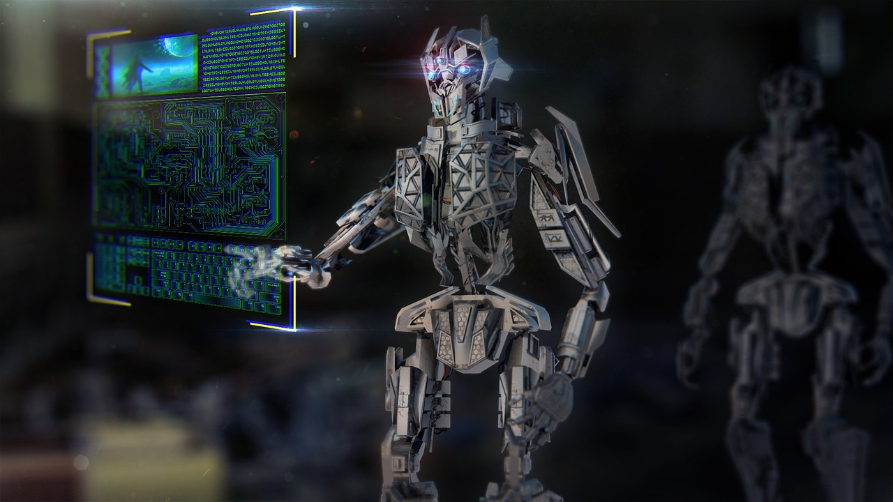
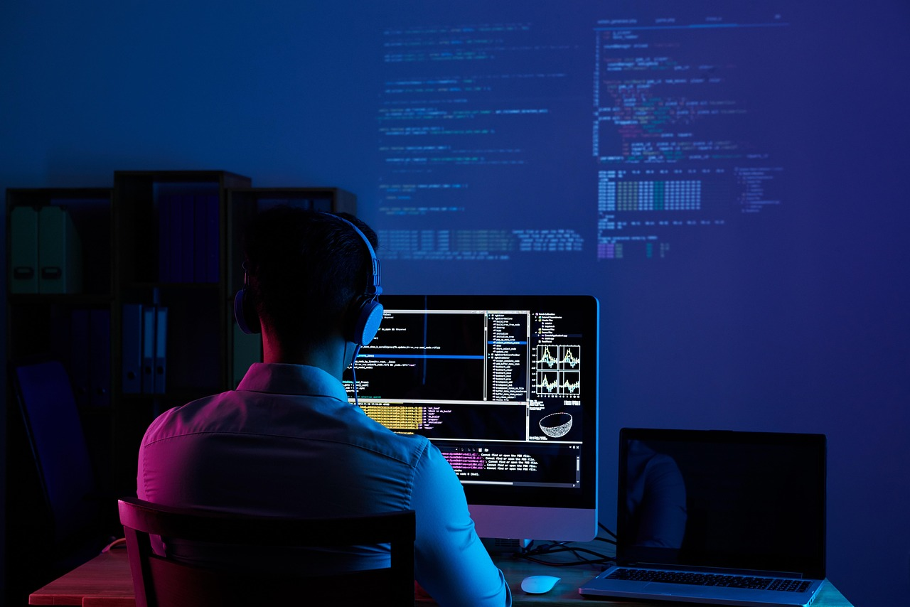

# AI第一次能替你"操作"电脑了：Claude Computer Use意味着什么

---

凌晨一点，处理完了第183封邮件。

还有87封未读，屏幕的蓝光刺得眼睛发酸。你叹了口气，心想：如果有个东西能帮我把这些邮件分类、提取关键信息、写好摘要，该多好。但下一秒否定了自己——这不是我一个人能搞定的事。

两周前，Anthropic发布了一个功能，名字叫Claude Computer Use。我更愿意叫它：**AI第一次能替你操作电脑了。**

不是生成一段文字，不是给你出主意，而是真真实实地替你移动鼠标、点击按钮、在网页里填表、在Excel里填数。

这篇文章，用普通人能听懂的话，讲清楚：它是什么，能干什么，正在发生什么，以及，你应该为此做什么。

---

## 它到底是什么

之前的AI，本质上是一个超级强大的"文字生成器"。你问它"帮我写封请假邮件"，它给你写一封。你让它"帮我分析这份数据"，它告诉你怎么分析——但具体操作，对不起，它做不了。它没有手。

这就像一个天才顾问，站在你旁边，告诉你该怎么做，但每一步都要你自己动手执行。你可以问它任何问题，但你始终是执行者。

Claude Computer Use改变了这件最根本的事。它给AI装上了手。

具体怎么实现的？它让Claude做两件事：**第一，看屏幕。** AI截取你电脑屏幕的图像，知道当前页面上有什么——按钮、输入框、表格，一目了然。**第二，用工具。** Anthropic提供了一套接口，Claude可以移动鼠标、点击按钮、打字、打开文件。

这两件事一组合，逻辑就变成了：你说"帮我把这份Excel整理成图表，发邮件给小明"，Claude看到屏幕→打开Excel→操作表格→生成图表→打开邮箱→发送。全程不用你动一根手指。

2026年3月，Anthropic又进了一步，发布Claude Dispatch——你可以用手机远程控制电脑上的Claude，让它在你离开电脑的时候继续干活。这意味着AI替我操作电脑，已经从"有人盯着才能用"进化到了"真正放手让它干"。

---

## 三个你会遇到的真实场景

**第一，做竞品调研。**

以前你要做这些：打开十几个网站，逐一查找产品价格和功能，把数据复制到Excel，整理成表格，写分析报告。熟练操作也要两个小时。

现在你只做一件事：告诉Claude你的需求，"帮我调研最近三个月国内AI写作工具市场，关注产品名称、定价、核心功能、用户评分，完成后整理成表格并写300字摘要"。然后你去喝咖啡。回来时，Claude已经完成了所有工作。

两分钟，而不是两小时。

更重要的是，Claude做这些工作的时候，你可以去做更有价值的事情——真正地思考这些数据意味着什么，而不是机械地复制粘贴。

**第二，每周重复的周报。**

打开飞书收集各部门数据，汇总到Excel，整理图表，写文字分析，排版导出。每周重复两小时。一年下来，96小时没了。

设置一个自动化流程，每天早上Claude自动登录系统，读取本周数据，生成初稿发到你的飞书。你只需要看一遍，修改，发送。

2026年3月刚发布的Dispatch还带来了一个新场景：你通勤路上用手机发个指令，让Claude在你到办公室之前就把周报初稿准备好。你走进办公室，报告已经在等你了。

**第三，协调多人会议。**

约一个涉及七八个人的会议，发了无数条消息，时间还是定不下来。

告诉Claude"帮我约一个和产品部、数据部、设计部三位负责人的会议，讨论下周上线方案"。它会自动读取你的日历和各部门日程，找到共同空闲时段，起草并发送邀请邮件。你只需要确认并发出去。

---

## 正在发生的一场竞争

这里有一个背景故事，能帮我们看清这波浪潮的紧迫性。

有一个开源项目叫OpenClaw，做了一件很酷的事：让用户通过WhatsApp、Discord来控制自己的电脑。对着手机说话，它就会在你的电脑上执行操作。这个项目在开发者社区迅速爆火。

Anthropic的反应很快。

2026年3月的数据显示，在短短30天内，Anthropic针对性地发布了四项功能，逐一对标OpenClaw的核心能力：OpenClaw有WhatsApp代理，Anthropic推出Dispatch；OpenClaw有Discord控制，Anthropic推出Claude Code Channels；OpenClaw有浏览器控制，Anthropic的Computer Use早已覆盖。

但有一个关键区别。OpenClaw在快速扩张中爆出了严重安全问题：2026年2月爆出的CVE-2026-25253漏洞，允许恶意网站在用户毫不知情的情况下劫持其AI智能体。OpenClaw的插件市场中有约12%的插件包含窃取密码和加密货币凭据的恶意代码，数千台安装了OpenClaw的设备直接暴露在公网上。

Anthropic的选择是：宁可牺牲一些便利性，也要加上安全护栏。Dispatch要求用户在场，不支持无人值守——不是因为做不到，而是不想走OpenClaw的老路。

这场竞争告诉我们一件事：AI操控电脑已经不是"未来愿景"，而是正在发生的商业战场。

---

## 一个被低估的趋势

Computer Use发布后，有一种论调很流行：**GUI要死了，以后直接说话就行。** 意思是，以后不用学Excel了，不用学PPT了，直接跟AI说"帮我做"就行。

Anthropic自己做了一项用户行为研究，结果很有意思：即使是重度Claude Code用户（使用超过750次），在自动执行过程中仍然保持很高的干预频率。天天用、用得很熟的人，也很难完全放手。

这背后有一个道理：**自然语言是低带宽的。** 你可以说"帮我整理邮件"，但你需要看到整理结果、选择哪些要回复、确认发送内容。纯粹"说出来就行"，并不是最高效的人机协作方式。

那未来是什么？

App不会消失，但App会进化成AI指挥中心。

未来的飞书，可能不只是协同办公软件，也是一张AI任务看板——你给AI分配任务，检查执行结果，确认放行。Outlook不只是收发邮件，还是你和AI一起处理信息的工作流引擎。Computer Use打开的不是"AI替代App"的门，而是"App成为AI和人之间翻译层"的大门。

想象一下，你对手机说"帮我把今天上午小明发来的合同草稿审阅一遍，把修改意见标注出来，发给法务确认"，这件事在你走进电梯的几秒钟内就完成了——而不是掏出电脑，打开邮件，找到附件，逐一审阅。

---

## 对你来说意味着什么

国内能用吗？暂时还不行，但不会太久。Dispatch的门槛是每月100美元，国内访问Claude API也受限。但这是大模型竞争的下一个主战场，国内厂商不可能缺席。

真正值得你思考的，不是"什么时候能用上"，而是：**你准备好了吗？**

以前你和AI的分工是：你说，AI答，你执行。现在AI可以替你执行了——但这就带来一个新问题：什么时候该放手，什么时候该盯着？

Anthropic的数据显示，即使是重度用户也无法完全放手。这意味着会用AI的人，不等于把所有事都交给AI。真正有价值的，是**知道什么时候监督、什么时候放手的判断力**。

这种判断力，不是等工具完善了才有的，而是从现在开始用、开始踩坑、开始积累的。工具会普及，但判断力不会凭空产生。

一个具体建议：拿一张纸，写下你过去一周做的所有工作，逐一标注"重复性"和"耗时"。标注最高的那几项，就是你AI自动化的第一批目标。常见的高价值场景包括：数据汇总和报表生成、邮件分类与初步回复、日程协调与会议安排、信息搜集和多平台同步更新。

---

这波浪潮已经来了。它不是某一天突然发生的，而是过去两年一点点积累，现在终于到了转折点。

AI第一次能替你操作电脑了。

但真正重要的不是这个"第一次"，而是它的后续——它不再只是帮你出主意，而是开始帮你动手了。

这波浪潮已经来了。它不是某一天突然发生的，而是过去两年一点点积累，现在终于到了转折点。Anthropic和OpenClaw的竞争，只是这场大潮的前奏。真正的主浪，还在后面。而你，要不要现在开始准备？

---

*本文配图来源：Pixabay（CC0授权）*
